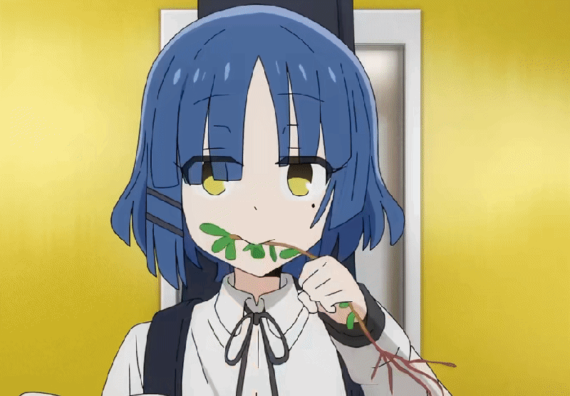
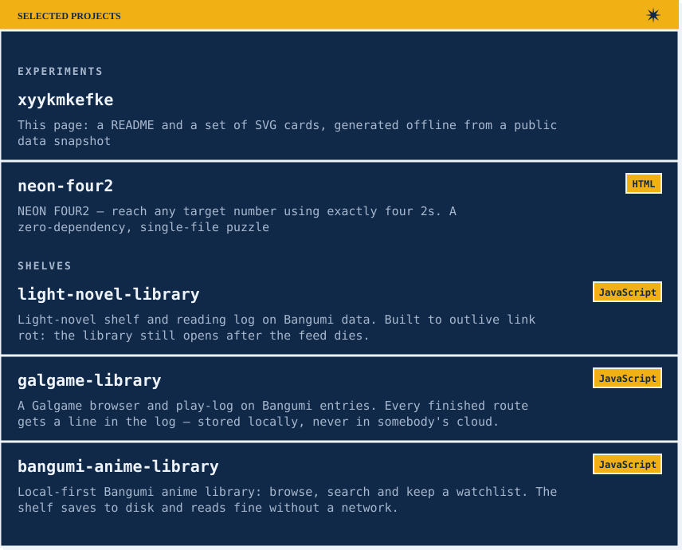

<!-- generated by profile-readme-pipeline; edit data/profile.json, not this file -->

# Deckard @xyykmkefke

<!-- BEGIN HUMAN: edit freely; preserved by build and exempt from drift -->
> I collect the stories I love, then build small tools to keep them close.

Anime, galgame and light novels are my shelves. Everything here runs <mark>offline</mark> and saves locally — no account, no sync service, no request to somebody else's server just to open a page.

**Now:** A reading log that survives dead links, and a quiet obsession with what GitHub really keeps when it <tt>sanitises</tt> a README.

***
<!-- END HUMAN -->

<kbd>[GitHub](https://github.com/xyykmkefke)</kbd>

<blockquote>

</blockquote>

### What I'm up to

- A local-first shelf for anime, galgame and light novels — everything saved to disk
- Small puzzle experiments that run as a single HTML file
- A scanner for text hidden in PDFs, because invisible words shouldn't count as words

Ryo is one of my favourite characters: quiet, dry, and always looking a little sideways. I keep her here as a reminder that a personal page should have some <code>personality</code> in it, not just a list of commits.
Her pictures live in this repo instead of an image host — every view would otherwise send a request to somebody else's server.

 

<picture>
  <source media="(prefers-color-scheme: dark)" srcset="assets/summary-dark.svg">
  <source media="(prefers-color-scheme: light)" srcset="assets/summary-light.svg">
  
</picture>

<picture>
  <source media="(prefers-color-scheme: dark)" srcset="assets/badges-dark.svg">
  <source media="(prefers-color-scheme: light)" srcset="assets/badges-light.svg">
  
</picture>

<picture>
  <source media="(prefers-color-scheme: dark)" srcset="assets/repositories-dark.svg">
  <source media="(prefers-color-scheme: light)" srcset="assets/repositories-light.svg">
  
</picture>

**Repositories:** <kbd>[xyykmkefke](https://github.com/xyykmkefke/xyykmkefke)</kbd> <kbd>[bangumi-anime-library](https://github.com/xyykmkefke/bangumi-anime-library)</kbd> <kbd>[galgame-library](https://github.com/xyykmkefke/galgame-library)</kbd> <kbd>[light-novel-library](https://github.com/xyykmkefke/light-novel-library)</kbd> <kbd>[neon-four2](https://github.com/xyykmkefke/neon-four2)</kbd>

Things I care about

- **Own your data** — Everything saves locally; no account, no sync, no service that can go quiet
- **Small over clever** — One tool per shelf, built enough that I actually use it
- **Next** — A reading log that still works when the links die

What I use

- **Runtime** — <tt>Python</tt> standard library, no dependencies
- **Output** — README plus dark and light SVG cards, zero external requests
- **Checks** — 14 gates covering contrast, labels and missing assets

About this page

- Content lives in one JSON snapshot; the README is rebuilt from it.
- Visuals are SVG files: GitHub sanitises README HTML but leaves repository assets alone.
- Cards follow prefers-color-scheme, so dark mode is a first-class citizen.

<blockquote>

</blockquote>
