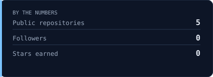
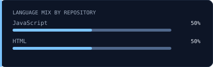

<!-- generated by profile-readme-pipeline; edit data/profile.json, not this file -->

# Deckard @xyykmkefke

<!-- BEGIN HUMAN: edit freely; preserved by build and exempt from drift -->
> Building local-first web apps for ACG libraries and small puzzles.

I make offline-friendly tools: anime, galgame and light-novel libraries, plus small puzzle experiments.

**Now:** Currently exploring local-first data, PWA offline experience, and reproducible build pipelines.
<!-- END HUMAN -->

[GitHub](https://github.com/xyykmkefke)

<picture>
  <source media="(prefers-color-scheme: dark)" srcset="assets/numbers-dark.svg">
  <source media="(prefers-color-scheme: light)" srcset="assets/numbers-light.svg">
  
</picture>

<picture>
  <source media="(prefers-color-scheme: dark)" srcset="assets/repositories-dark.svg">
  <source media="(prefers-color-scheme: light)" srcset="assets/repositories-light.svg">
  
</picture>

<picture>
  <source media="(prefers-color-scheme: dark)" srcset="assets/languages-dark.svg">
  <source media="(prefers-color-scheme: light)" srcset="assets/languages-light.svg">
  
</picture>

**Repositories:** [bangumi-anime-library](https://github.com/xyykmkefke/bangumi-anime-library) · [galgame-library](https://github.com/xyykmkefke/galgame-library) · [light-novel-library](https://github.com/xyykmkefke/light-novel-library) · [neon-four2](https://github.com/xyykmkefke/neon-four2)

How this page is built

Generated offline by profile-readme-pipeline from a JSON snapshot.
No API token, no image host, no GitHub Action: sync, build, commit the diff.
Data collected 2026-11-26 via GitHub public API.

Contrast on `#0d1526`: 15.62:1 for body text. Light theme `#ffffff`: 15.80:1.

