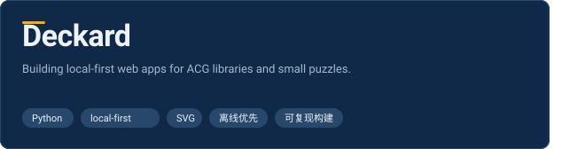
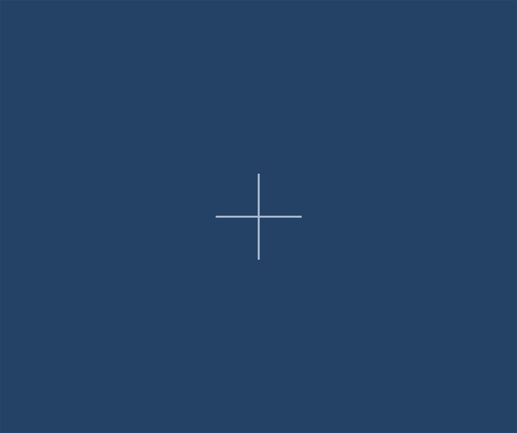

<!-- generated by profile-readme-pipeline; edit data/profile.json, not this file -->

<picture>
  <source media="(prefers-color-scheme: dark)" srcset="assets/hero-dark.svg">
  <source media="(prefers-color-scheme: light)" srcset="assets/hero-light.svg">
  
</picture>

<!-- BEGIN HUMAN: edit freely; preserved by build and exempt from drift -->
I make offline-friendly tools: anime, galgame and light-novel libraries, plus small puzzle experiments.

**Now:** Currently exploring local-first data, PWA offline experience, and reproducible build pipelines.
<!-- END HUMAN -->

<kbd>[GitHub](https://github.com/xyykmkefke)</kbd>

### <strong>01</strong> 在做什么

- 做一个 JSON 快照 → README 的生成流水线，14 道门禁全程离线
- 研究 `SVG` 动效在 GitHub 上的真实边界（CSP 只放行文件内 `<style>`）
- 写一个 PDF 隐藏文字 / 提示注入扫描工具

上面三条是我这阵子在忙的事。左边这张图是我最喜欢的角色之一 —— 用本地文件而不是外链图床，是因为主页每被打开一次，外链就会向第三方发一次请求；换成仓库里的 <code>SVG</code> 与 GIF，页面加载不再依赖别人的可用性。
同样的取舍贯穿整页：没有统计服务的 <code>badge</code>，没有运行时 <code>API</code> 调用，连字体都退化成系统等宽字体栈而不是 webfont。

 

### <strong>02</strong> 语言构成

<picture>
  <source media="(prefers-color-scheme: dark)" srcset="assets/summary-dark.svg">
  <source media="(prefers-color-scheme: light)" srcset="assets/summary-light.svg">
  
</picture>

<picture>
  <source media="(prefers-color-scheme: dark)" srcset="assets/badges-dark.svg">
  <source media="(prefers-color-scheme: light)" srcset="assets/badges-light.svg">
  
</picture>

### <strong>03</strong> 角色动图

  

### <strong>04</strong> 仓库

<picture>
  <source media="(prefers-color-scheme: dark)" srcset="assets/repositories-dark.svg">
  <source media="(prefers-color-scheme: light)" srcset="assets/repositories-light.svg">
  
</picture>

**Repositories:** <kbd>[xyykmkefke](https://github.com/xyykmkefke/xyykmkefke)</kbd> <kbd>[bangumi-anime-library](https://github.com/xyykmkefke/bangumi-anime-library)</kbd> <kbd>[galgame-library](https://github.com/xyykmkefke/galgame-library)</kbd> <kbd>[light-novel-library](https://github.com/xyykmkefke/light-novel-library)</kbd> <kbd>[neon-four2](https://github.com/xyykmkefke/neon-four2)</kbd>

这几件事的取舍

- **主线** — 让主页可重建：内容进 JSON，产物进 git，两者漂移即失败
- **副线** — 把「GitHub 上什么 HTML 能活」测成一张可查的表，而不是靠猜
- **下一步** — 把同一个内核接到博客与项目页，不止主页

技术栈

- **运行时** — Python 标准库，零第三方依赖
- **产物** — README + 明暗两套 `SVG`，无外部请求
- **门禁** — 14 项检查，含对比度、外部资源、图片完整性、孤儿素材

这页是怎么生成的

- 内容全部来自 JSON 快照，改数据不改代码。
- 视觉下沉到 `SVG`：README 里的 HTML 会被 sanitizer 拆掉，仓库里的 `.svg` 不会。
- 每张卡片明暗两版，用 `<picture>` 按 `prefers-color-scheme` 切换。

Data collected 2026-11-26 via GitHub public API.

Contrast on `#102948`: 13.15:1 for body text. Light theme `#faf7f0`: 13.70:1.

