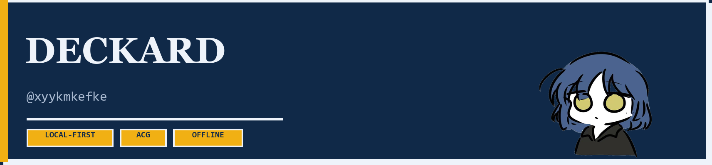
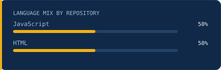
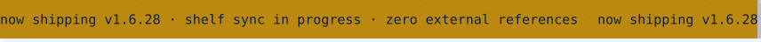
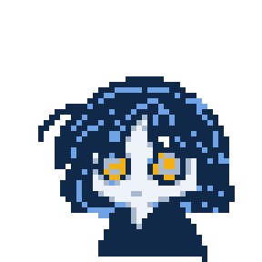

<!-- generated by profile-readme-pipeline; edit data/profile.json, not this file -->

<picture>
  <source media="(prefers-color-scheme: dark)" srcset="assets/banner-dark.png">
  <source media="(prefers-color-scheme: light)" srcset="assets/banner-light.png">
  
</picture>

 

# Deckard @xyykmkefke

<picture>
  <source media="(prefers-color-scheme: dark)" srcset="assets/dotmatrix-dark.svg">
  <source media="(prefers-color-scheme: light)" srcset="assets/dotmatrix-light.svg">
  
</picture>

<a href="https://bgm.tv/subject/23014">
<picture>
  <source media="(prefers-color-scheme: dark)" srcset="assets/now_playing-dark.svg">
  <source media="(prefers-color-scheme: light)" srcset="assets/now_playing-light.svg">
  
</picture>
</a>

<!-- BEGIN HUMAN: edit freely; preserved by build and exempt from drift -->
> Pipelines by day, shelves by night — I build small, local-first tools for the stories I keep coming back to.

:books: The shelves hold anime, visual novels and light novels. Most of these tools exist because a link died or a service shut down once too often — so everything runs <mark>offline</mark>, saves to disk, and answers to nobody else's server.

> [!TIP]
> Click the vinyl card above to hear what's on it.

:wrench: **Now:**
- [x] profile pipeline — shipped, 15 gates green
- [ ] PDF scanner — teaching it to see printed text
- [ ] streak graph — filling since 2026-11-28
<!-- END HUMAN -->

 

<kbd>[GitHub](https://github.com/xyykmkefke)</kbd>

<blockquote>

</blockquote>

 

<strong>CURRENTLY</strong>

- **Building** — the play-log half of galgame-library — routes, saves and stats, all local
- **Shipping** — the v1.6.2x cycle: watchlist sync edge cases
- **Learning** — how far CommonMark HTML blocks can be pushed before they push back

 

Yamada Ryo, from Bocchi the Rock — quiet, dry, always looking a little sideways. She is the character I keep closest, and the one I would want to be caught imitating: unbothered, easily delighted, and incapable of pretending to care about something she does not.
A shelf is only worth keeping if it is yours. Most of what is here started as a note to myself and turned into a tool I still open, months later.

 

 

<strong>AT A GLANCE</strong>

<picture>
  <source media="(prefers-color-scheme: dark)" srcset="assets/summary-dark.svg">
  <source media="(prefers-color-scheme: light)" srcset="assets/summary-light.svg">
  
</picture>

<picture>
  <source media="(prefers-color-scheme: dark)" srcset="assets/badges-dark.svg">
  <source media="(prefers-color-scheme: light)" srcset="assets/badges-light.svg">
  
</picture>

<picture>
  <source media="(prefers-color-scheme: dark)" srcset="assets/repositories-dark.svg">
  <source media="(prefers-color-scheme: light)" srcset="assets/repositories-light.svg">
  
</picture>

<picture>
  <source media="(prefers-color-scheme: dark)" srcset="assets/streak-dark.svg">
  <source media="(prefers-color-scheme: light)" srcset="assets/streak-light.svg">
  
</picture>

counting since 2026-11-28

<picture>
  <source media="(prefers-color-scheme: dark)" srcset="assets/marquee-dark.svg">
  <source media="(prefers-color-scheme: light)" srcset="assets/marquee-light.svg">
  
</picture>

 

<strong>SHIPPING</strong>

**Repositories:** <kbd>[light-novel-library](https://github.com/xyykmkefke/light-novel-library)</kbd> <kbd>[galgame-library](https://github.com/xyykmkefke/galgame-library)</kbd> <kbd>[bangumi-anime-library](https://github.com/xyykmkefke/bangumi-anime-library)</kbd> <kbd>[neon-four2](https://github.com/xyykmkefke/neon-four2)</kbd>

- **v1.6.31** — shipped · bangumi-anime-library · 2026-11-28
- **v1.6.30** — shipped · bangumi-anime-library · 2026-11-28
- **v0.1.0** — shipped · neon-four2 · 2026-11-28
- **v0.1.0** — shipped · light-novel-library · 2026-11-28
- **v0.1.0** — shipped · galgame-library · 2026-11-28

 

Principles

<dl>
<dt>Own your data</dt>
<dd>Everything saves locally — no account, no sync, no service that can go quiet</dd>
<dt>Small over clever</dt>
<dd>One tool per shelf, built until I actually reach for it</dd>
<dt>Next</dt>
<dd>A reading log that still works when the links die</dd>
</dl>

Toolchain

<dl>
<dt>Runtime</dt>
<dd><code>Python</code> standard library, no dependencies</dd>
<dt>Output</dt>
<dd>One <code>README</code> and a set of <code>SVG</code> cards, rebuilt from a single snapshot</dd>
<dt>Checks</dt>
<dd>Gated on contrast, labels and missing assets</dd>
</dl>

Colophon

<dl>
<dt>Snapshot</dt>
<dd>Content lives in one <code>JSON</code> file; the page is rebuilt from it, never hand-edited.</dd>
<dt>Cards</dt>
<dd>Every card is an <code>SVG</code> committed to this repository — GitHub sanitises README HTML but leaves repository assets alone.</dd>
<dt>Themes</dt>
<dd>Cards follow <code>prefers-color-scheme</code>, so light and dark are both first-class.</dd>
</dl>

 

 

